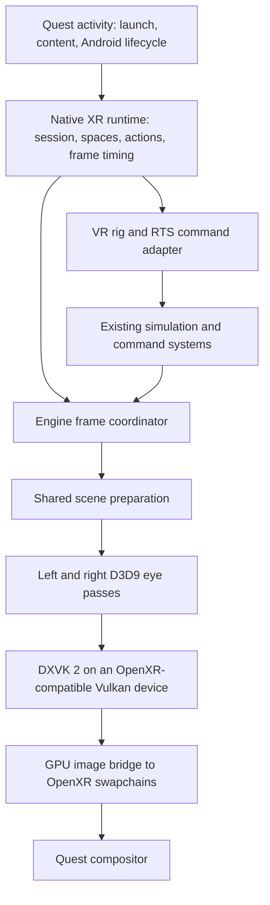

# Quest 3 standalone tabletop VR port plan

Prepared 2026-09-23 from Android repository `eb1bb62` and Perimeter submodule `fd6daaed`. This is an architecture and implementation plan based on source inspection, not a headset compatibility or performance result. No builds or device experiments were performed for this analysis.

## Direction

Build a native OpenXR tabletop application for Quest 3, retaining the engine's D3D9 renderer through the pinned **DXVK 2.7.1** revision. The player sees the battlefield as a miniature world and moves and scales the table while retaining natural head movement. Tabletop is the only planned gameplay viewpoint.

The port is feasible enough to justify a prototype, but its performance and DXVK/OpenXR compatibility remain unproven. Resolve graphics interoperability before investing in the complete VR interface. Tabletop still requires stereo rendering, OpenXR integration, and comfortable controls; it is not inherently cheaper to render when the whole map is visible.

Scope is standalone ARM64, controller input, existing game content and simulation, and DXVK 2 only. Do not develop Sokol or DXVK 1 VR paths. Passthrough, hand tracking, multiplayer UX, and advanced reprojection can follow the tabletop single-player experience.

## Code findings and implications

References are to the inspected revisions; line numbers will move during implementation.

| Area | Evidence | Consequence |
| --- | --- | --- |
| Android entry | [Manifest](../app/src/main/AndroidManifest.xml), [MainActivity](../app/src/main/java/com/queststoredb/perimeter/MainActivity.kt) | Current launch is an Android panel followed by an SDL activity in `:game`. There is no native OpenXR session implementation in `app/src` or `Perimeter/Source`. |
| DXVK build | [AndroidDxvk.cmake](../app/src/main/cpp/cmake/AndroidDxvk.cmake#L154) | Generation 2 pins `c3dd74be6baec53786d4e064a572185b70347a17`; its cached pristine `meson.build` identifies 2.7.1. The build currently packages both generations. Add a Quest configuration that builds/packages only generation 2. |
| DXVK loading | [AndroidDxvkLoader.cpp](../app/src/main/cpp/AndroidDxvkLoader.cpp#L40), [GameLaunchOptions.kt](../app/src/main/java/com/queststoredb/perimeter/GameLaunchOptions.kt#L48) | The existing boundary exposes D3D9 creation and an SDL window. Quest needs an XR bootstrap before D3D9 creation, and a fixed generation-2 selection. The existing Vulkan version probe alone is insufficient to establish XR compatibility. |
| Presentation | [D3DRender.cpp](../Perimeter/Source/Render/D3D/D3DRender.cpp#L772) | `cD3DRender::Flush()` invokes D3D9 `Present`. XR needs a separate submission path, runtime pacing, and no required Android window presentation. |
| Render targets | [D3DRenderDraw.cpp](../Perimeter/Source/Render/D3D/D3DRenderDraw.cpp#L15) | Target switching exists, but `RestoreRenderTarget()` restores the window backbuffer. Nested shadows/reflections must restore the current eye target. `SetDrawNode()` caches camera identity; target changes must invalidate that cache where necessary. |
| Update/draw coupling | [GameShell.cpp](../Perimeter/Source/UserInterface/GameShell.cpp#L731), [Show](../Perimeter/Source/UserInterface/GameShell.cpp#L869) | `GraphQuant()` calls `Show()`, which advances clocks, updates placement/UI, draws the world and HUD, and presents. Calling it once per eye would duplicate frame work and time advancement. |
| Scene preparation | [Scene.cpp](../Perimeter/Source/Render/src/Scene.cpp#L122) | `Draw()` performs list updates, animation, visibility, shadows, and rendering. `Animate()` already consumes its time delta, so a second scene draw alone does not necessarily animate twice; that guard does not make the entire draw path stereo-safe. `PreDraw()` and `PostDraw()` are empty here. |
| Camera projection | [cCamera.cpp](../Perimeter/Source/Render/src/cCamera.cpp#L340) | The normal projection sets perspective offsets to zero. `ATTRCAMERA_NOT_CALC_PROJ` can preserve a supplied matrix, but frustum construction and ray generation still need an asymmetric-projection audit. Replacing only the projection matrix is insufficient. |
| Camera controls/picking | [CameraManager.cpp](../Perimeter/Source/Game/CameraManager.cpp#L431) | Picking converts a screen cursor into a scene ray; drag uses a separate flat plane. VR needs controller rays independent of a screen cursor and a rig independent of the legacy orbit camera. |
| Terrain lifecycle | [TileMapRender.cpp](../Perimeter/Source/Render/tilemap/TileMapRender.cpp#L251) | `PreDraw()` clears draw flags, frees tiles, and recalculates camera-dependent render lists. Sequential eye passes can change shared terrain state. Prepare residency/LOD once for the stereo view family. |
| Simulation scheduling | [ht.cpp](../Perimeter/Source/HT/ht.cpp#L205), [Runtime.cpp](../Perimeter/Source/Game/Runtime.cpp#L479) | Logic and graphics already have distinct paths and synchronization. Retain their tick/command semantics while introducing one XR graphics frame with two views. |
| RTS actions | [Universe.cpp](../Perimeter/Source/Game/Universe.cpp#L370), [ShellCmd.cpp](../Perimeter/Source/UserInterface/ShellCmd.cpp), [Installer.cpp](../Perimeter/Source/UserInterface/Installer.cpp#L155) | World-position commands and a world-position building placement overload are reusable. Adapt controller intent to these systems instead of implementing new simulation rules. |
| Sound | [Runtime.cpp](../Perimeter/Source/Game/Runtime.cpp#L951) | The listener follows `terCamera->matrix()`. VR should use a central head pose, with distance attenuation adjusted to the chosen world scale. |
| Diagnostics | [AndroidFrameTiming.h](../app/src/main/cpp/AndroidFrameTiming.h), [dxvkSmoke](../dxvkSmoke/src/main/cpp/DxvkSmoke.cpp) | Reuse native timings and the smoke-test structure, adding XR timing and compatibility fields. Existing phone/window benchmarks do not establish Quest stereo performance. |

## Architecture and ownership

Proposed Android-owned components under `app/src/main/cpp/xr/`:

| Component | Responsibility |
| --- | --- |
| `XrRuntime` | Loader, instance/session, events, spaces, swapchains, frame lifecycle, extension discovery. |
| `XrDxvkBridge` | DXVK bootstrap hooks, Vulkan interop, target transfer, queue coordination and resource lifetime. |
| `XrFrameCoordinator` | Once-per-frame preparation, eye passes, UI layer production and submission. |
| `XrCameraRig` | Tracking-to-world transform, tabletop scale and placement, navigation, and recenter policy. |
| `XrInput` | OpenXR actions, controller poses, haptics and action cancellation. |
| `VrCommandAdapter` | Picking, selection, build/terrain tools, command queueing and panel interaction. |
| `VrPanels` | Comfortable placement of menus/HUD and mapping panel hits into existing UI coordinates. |

Names are proposed interfaces, not existing classes. Keep OpenXR/Vulkan types out of gameplay APIs. Small engine changes are necessary: a frame/view-family boundary, camera projection and ray support, render-target ownership, and world-space interaction seams. Use neutral C++ structures for these boundaries. Exodus currently supplies small platform utilities rather than a ready-made XR backend; avoid concentrating rendering and input logic there just because it is a platform layer.

## First technical gate: DXVK 2 and OpenXR on one device

Use `XR_KHR_vulkan_enable2`. Initialize the Android loader, create the XR instance/system, and query graphics requirements before initializing D3D9. Route DXVK's Vulkan instance and device creation through narrow Android-only callbacks to `xrCreateVulkanInstanceKHR` and `xrCreateVulkanDeviceKHR`; select the physical device returned by `xrGetVulkanGraphicsDevice2KHR`. Preserve DXVK's required features, extension lists, queue selection, and error diagnostics. The binding requires those creation calls and the runtime-selected physical device; obtaining arbitrary DXVK handles after startup is not enough. [Khronos Vulkan binding requirements](https://registry.khronos.org/OpenXR/specs/1.1/man/html/XrGraphicsBindingVulkan2KHR.html)

Source inspection of the cached pinned DXVK shows direct Vulkan creation in `src/dxvk/dxvk_instance.cpp:248` and `src/dxvk/dxvk_adapter.cpp:225`. It also has internal instance/device import machinery, but this is not an exposed D3D9 initialization contract. Prefer the narrow creation callbacks first; consider a D3D9 import extension only if that prototype demonstrates a smaller maintained change. Its existing OpenXR extension provider is registered under `_WIN32`, so it does not implement this Android integration.

Keep these changes in the existing reproducible patched-source build, controlled by an XR option in `AndroidDxvk.cmake` / `patch_android_dxvk.py`. Never edit generated `.cxx` source as the implementation. Version the callback ABI, register it before `Direct3DCreate9`, and retain it until DXVK destruction. Diagnose unsupported feature/API combinations explicitly.

The pinned D3D9 interop interfaces expose device/queue/image handles, image transitions, command flushing and queue locks. They can support a GPU transfer bridge. Their `CreateImage` method creates a resource; it does not accept an external `VkImage`, so direct wrapping of an OpenXR image is additional work. [Pinned DXVK interfaces](https://github.com/doitsujin/dxvk/blob/c3dd74be6baec53786d4e064a572185b70347a17/src/d3d9/d3d9_interfaces.h)

For the first version, render into two D3D9 texture targets plus depth surfaces, then copy or blit on the GPU into acquired OpenXR images on the same device. Negotiate actual swapchain formats, dimensions and usage flags; check transfer/format support. If necessary, use a small Vulkan conversion pass for presentation, keeping all game rendering in DXVK 2. Begin with one single-layer swapchain per eye to keep resource ownership simple. Use runtime-recommended sizes with an explicit measured resolution scale, not Android panel dimensions.

The smoke prototype must resolve these details before integration:

- Flush D3D9 work before external Vulkan use. A command-stream flush is not proof that the GPU is idle.
- Submit explicit barriers and GPU dependencies; restore DXVK image layouts before reuse. Track per-frame completion for staging targets and command buffers.
- Serialize use of the shared Vulkan queue, including OpenXR operations that may access it. Never call D3D9 methods while holding DXVK's submission lock; arrange flush/lock order to avoid deadlocks.
- Honor acquire/wait/release and the Vulkan layout requirements at handoff. Do not modify images after release, destroy runtime-owned images, or let pending GPU work reference destroyed resources.
- Prove D3D9 startup/reset can operate with an unused SDL window or a minimal XR-specific offscreen path. Do not require a functioning window swapchain or normal `Present()` to make rendering progress.
- Verify channel order, sRGB handling, vertical orientation, MSAA resolve, and depth/stencil compatibility independently.

OpenXR and Vulkan define the synchronization contract; serialize the runtime and DXVK on their shared queue. [OpenXR Vulkan extension specification](https://registry.khronos.org/OpenXR/specs/1.1-khr/pdf/xrspec.pdf)

Direct rendering into OpenXR images is a later optimization: add a narrowly scoped external-image D3D9 wrapper with non-owning lifetime semantics, supported formats, tracked layouts and attachment views. Keep the transfer path as a reference until the direct path is correct and measurably faster. No CPU readback in either path.

## Stereo frame and engine changes

The proposed frame order is:

1. Process Android and XR lifecycle events; run the XR frame loop only in a running session.
2. `xrWaitFrame`, then `xrBeginFrame`; retain the returned predicted display time and `shouldRender`.
3. Synchronize controller actions and obtain valid controller poses. Advance permitted game/UI work once, preserving existing simulation cadence and thread contracts.
4. Prepare a consistent scene state. Locate eye views for predicted display time late enough to reduce pose age, before final per-eye culling.
5. If rendering is requested and poses are valid, acquire/wait eye images, prepare shared terrain/scene resources, then draw each eye from the same state into its own color/depth target.
6. Produce menus/panels, transfer images, release swapchain images, and submit a projection layer with the corresponding runtime-space eye poses and FOVs.
7. End every begun frame correctly, including frames with zero layers when rendering is skipped. Release only images that were acquired and successfully waited on.

Use the runtime's pacing and predicted display time. [xrWaitFrame](https://registry.khronos.org/OpenXR/specs/1.1/man/html/xrWaitFrame.html), [xrLocateViews](https://registry.khronos.org/OpenXR/specs/1.1/man/html/xrLocateViews.html), [swapchain release](https://registry.khronos.org/OpenXR/specs/1.1/man/html/xrReleaseSwapchainImage.html)

Refactor `GameShell::Show()` into frame preparation, world-view drawing, UI drawing and completion. Retain a one-view implementation for ordinary Android/desktop callers. Do not run `GraphQuant()` twice, duplicate command dispatch, or advance clocks once per eye. Keep scene references valid across both eye passes under the existing logic/graphics synchronization rules.

Split `cScene::Draw()` preparation where needed: animation/resource changes once per frame; visibility, transparency ordering and billboards per eye. Initially accept two geometry submissions. Vulkan multiview is not a switch that automatically converts D3D9 draw calls and shaders into a stereo renderer.

Render-target restoration must return to the enclosing eye target after shadow/reflection work. Audit viewport/scissor dimensions, fullscreen effects, cached camera state, stencil clears, UI coordinates and readback/movie paths for window assumptions. Share shadow maps only when their coverage is correct for both eyes; preserve separate eye-dependent reflections and transparent ordering as needed.

Terrain needs a view-family preparation step before unrestricted stereo gameplay: choose residency and a common LOD from both views, conservatively retain tiles needed by either eye, and perform deformation/texture/seam updates once. Maintain separate visibility/draw lists without freeing another eye's resources. The existing [terrain LOD plan](terrain-lod-reimplementation-plan.md) is relevant; reuse its persistent-tile direction if needed. Do not make the entire terrain rewrite a prerequisite for the first low-complexity stereo scene.

## Tabletop camera and scale

Represent the VR camera as a navigation rig plus physical tracking. Do not drive the legacy RTS orbit camera directly from headset yaw/pitch.

For positions, define a single transform:

`p_world = rig_origin + units_per_meter * R_world_from_tracking * p_tracking`

Apply its basis to orientations and controller rays; invert the resulting eye pose for the engine view matrix. Use runtime-supplied left/right poses and asymmetric FOVs. Convert OpenXR's axes to the engine's conventions explicitly, including handedness, matrix ordering and clip-depth conventions. Derive frustum planes, world-to-screen projection and unprojection consistently. Keep submitted OpenXR poses in the layer's XR reference space, rather than submitting engine-scaled coordinates.

The accepted Phase 2 camera already presents and renders gameplay as tabletop. Phase 3 builds on that view; it does not add another camera mode or replace the current camera. Keep physical head pose tracked at native OpenXR scale; when scale control is added, apply game-world scale only to the mapping between the table and game coordinates. Runtime IPD continues to determine stereo separation. HUD text and controls stay in XR meters so they remain readable as table scale changes. Extend the existing rig transform and use its inverse for eye cameras, controller picking, placement, and table manipulation.

Support controller-driven table translation and scale adjustment using the current gaze depth. Recompute the gaze reference from the central view while scaling; do not latch a world point. Apply horizontal scale-depth compensation along the same normalized world X/Y heading as left-stick movement, retaining the last stable heading near vertical gaze. Add equally fast vertical movement along world Z, perpendicular to terrain: zoom out moves backward and up, and zoom in moves forward and down. Do not normalize the combined horizontal/vertical vector, as that would reduce each component's speed. Compensate for the scale change of physical head displacement so it does not add unintended motion. The gaze reference determines compensation depth rather than a fixed pivot direction. Do not implement scaling as legacy RTS camera orbit-distance zoom. Two-hand translation and scaling can follow once the one-controller path is stable. The user accepts the current table placement and Quest Meta-button recenter as its reset; preserve that behavior across runtime reference-space changes without emitting commands or jumping the table. Seated use must not require floor tracking.

Use `scaleMovementMultiplier_ = 0.5` to halve the position shift accompanying scaling, giving approximately 80 game units per second for each horizontal and vertical component at full right-stick deflection. Keep the exponential scale rate at `2.1` per second; apply the multiplier to both movement components, leaving tracked-head scale compensation intact.

Move the left stick along the in-game terrain plane (world X/Y, constant world Z). Stick up follows the central headset forward direction projected onto that plane; stick right strafes perpendicular to that heading. Compose headset orientation with the game-camera transform before projection, then convert the horizontal world delta into rig coordinates. Normalize the projected heading so looking down does not reduce movement speed; retain the last stable heading near a vertical gaze. Constrain this movement to the gameplay sky sphere's cross-section at the current height, with a margin for physical leaning. Preserve table height and natural head tracking. Game camera tours or restores should adjust the table pivot only through an intentional transition, or appear on the panel. Spatial sound follows the central head pose; tune strategic-distance audibility for miniature scale.

## RTS input and interface

Use OpenXR actions and suggested bindings for supported Quest controllers. SDL remains useful for sound, existing input compatibility and the platform shell; pose/controller acquisition belongs to OpenXR. Make handedness configurable and clear held actions on focus loss or controller disconnection.

| Intent | Initial interaction |
| --- | --- |
| Select | Dominant trigger raycasts a unit; modifier adds/removes selection. |
| Group select | Explicit selection mode with a controller-drawn ground area; retain squad/group shortcuts. |
| Move/attack/interact | Separate command action on the current target, with visible preview and confirmation feedback. |
| Queue commands | Held modifier or explicit queue toggle, mapped to existing command modes. |
| Build/rotate/cancel | World-ray placement ghost, snap rotation, clear validity feedback, confirm/cancel actions. |
| Terraform | Ground ray and visible brush footprint, adjustable radius, explicit start/stop and mode selection. |
| Navigate | Translate the table and adjust its scale around the current gaze pivot. |
| Strategic controls | Repositionable panel for production, research, upgrades, squads, minimap, objectives and pause. |

Reuse `terScene::Trace()` for terrain intersection after applying map bounds and distance limits; add an appropriate unit/object ray query using existing selection filters. A terrain hit alone cannot select flying units. Apply visibility/fog-of-war, ownership and command validity rules through existing systems. Route confirmed commands through `terUniverse`/selection and the established logic queue. Do not keep raw unit pointers across frames when units may be deleted.

Use a semantic interaction context carrying world ray, hit position/object, modifiers, and command intent. Adapt screen-based shell callers at the boundary. Reuse `terBuildingInstaller::SetBuildPosition(Vect3f, angle, player)` for placement while preserving script and terrain checks. Ground dragging and selection-area semantics need explicit treatment on slopes and near map edges.

Initially render existing menus/HUD into a texture on a movable world-space panel or OpenXR quad layer. Transform controller hits into its original pixel coordinates for UI events. World input must not fire through the panel. Keep selection markers, paths, brush footprints and placement previews in stereo world space. A 2D panel is appropriate for menus, not a substitute for stereo battlefield rendering.

The tablet's Zeroplast and erase buttons also enable a world-space brush in the XR view. Prefer the right-hand aim ray, with the left hand as a tracking fallback, and retain the stroke's owning hand until trigger release. Show the terrain brush radius in both eyes; hold the trigger to paint and release it to send the existing region-change command. Match tablet brush bounds, add/erase operations, and replay restrictions. Suppress world painting over the tablet or without a terrain hit, and end strokes on tracking/focus loss, recenter, or camera-control locks. Cancel exits the tool. Keep ordinary selection and movement commands from consuming the same trigger input.

Progressively replace dense HUD interactions with comfortable panels/radial commands and controller prompts. Keep text, targets and panel distance usable across seated/standing play and table scales. Provide all keyboard-dependent functions needed to complete a mission, including save/load, naming/text entry, mission dialogs, pause and exit. Compose may serve Android setup screens; it does not automatically become an XR panel.

## Android lifecycle and packaging

Add a Quest build dimension/configuration with its own manifest and native XR option. Reuse content storage and the existing engine library. Keep a small activity responsible for Android lifecycle and JNI context, with the session owned by native code. Prototype reusing SDLActivity; if its surface-driven pause logic blocks XR, introduce a dedicated Quest host with an explicit SDL lifecycle adapter.

Add the XR launcher category and initialize the loader with Java VM/activity context. Pin a tested loader dependency rather than copying an old sample version blindly. Meta documents the Khronos Android loader and required Android initialization extensions. [Meta OpenXR setup](https://developers.meta.com/horizon/documentation/native/android/mobile-openxr/)

Keep content selection/permission setup available before XR launch, then enter the XR activity directly for normal play. Store setup state across the separate game process. Account for headset removal, dashboard focus changes, session stop/loss, Android pause/resume, loading and return to launcher. Current `MainActivity.onDestroy()` discards the game process because native globals are not safely reinitialized; preserve that constraint initially, with orderly XR/GPU teardown first. Do not interpret a transient loss of focus as a full restart.

Pause single-player gameplay appropriately on focus loss; preserve head tracking/rendering when the session remains visible. For long mission loads, present an XR loading layer if the engine load path can be separated safely; identify blocking global initialization before introducing a render thread. A moving head must not be tied to simulation speed or asset-loading stalls.

Use the Studio-compatible Gradle cache, host ccache, normal signing, and `releaseBenchmark` diagnostics variant from AGENTS.md. Keep O2/ThinLTO defaults for the control. Record the new Quest task names once implemented; no Quest Gradle task exists in this plan yet. Recheck current distribution manifest/SDK/storage requirements when preparing a release; the source's `targetSdk = 37` is not evidence of Quest store eligibility.

## Performance approach

Set **72 Hz native rendering** as the initial proposed target: 13.89 ms per displayed frame. Evaluate 90 Hz (11.11 ms) after sustained measurements. These are project targets, not measured capabilities. CPU and GPU work overlap, so measure their critical paths and compositor deadlines rather than adding average stage times. Reserve margin for runtime work, scheduling variation and thermal changes.

Measure engine preparation, each eye's CPU submission, GPU world rendering, transfer cost, XR wait/acquire/submit, missed frames, memory and load spikes separately. Record runtime/OS, driver, DXVK revision, resolution, refresh rate and settings. SurfaceFlinger window timings alone do not describe XR delivery.

Proposed initial acceptance criteria: three repeatable runs for each representative workload, followed by a 30-minute thermal session; less than 1% missed application frames after warm-up, no recurring multi-frame stalls during ordinary navigation, and no unbounded memory growth across repeated mission loads. At 72 Hz, aim for CPU application work and GPU application work each below 11 ms at P95, excluding intentional runtime pacing waits. Treat these as starting engineering gates to refine against actual runtime overhead and in-headset results, not a promise that this code already meets them.

Prioritize according to measurements:

1. Shared terrain/scene updates and elimination of resource churn during navigation.
2. Draw-call/batching cost and expensive shadows/reflections/particles at large overview distances.
3. Eye resolution scaling and quality presets with stable text/UI resolution.
4. Direct swapchain-image rendering if the extra transfer is material.
5. Fixed foveation after its attachment/image requirements are supported end to end.

### Model rendering review (2026-10-02)

Source inspection identifies three costs to measure in dense Quest scenes; their relative frame-time impact has not been measured in a headset:

- Each eye calls `DrawView()`, which repeats model visibility checks, mesh preparation, material sorting, and mesh submission. Scene animation and terrain view-family preparation are shared, but model drawing remains per eye. Measure CPU traversal/submission and GPU model time separately during heavy combat. See [`Scene.cpp`](../Perimeter/Source/Render/src/Scene.cpp) and [`GameShell.cpp`](../Perimeter/Source/UserInterface/GameShell.cpp).
- Shadow and reflection camera setup occurs within each eye's scene pass when those features are enabled. Profile their extra geometry passes before changing them. Share shadow rendering only if one map covers both eyes correctly; reflections may require separate eye views. See [`Scene.cpp`](../Perimeter/Source/Render/src/Scene.cpp) and [`TileMap.cpp`](../Perimeter/Source/Render/tilemap/TileMap.cpp).
- Controller laser distance calculation visits every live unit model each XR frame. Bounds tests reject most rays, but candidates can require per-triangle tests for both hands. Measure this CPU cost in large battles and consider a spatial candidate query if it is significant. See [`GameShell.cpp`](../Perimeter/Source/UserInterface/GameShell.cpp) and [`XrUnitRay.cpp`](../app/src/main/cpp/xr/XrUnitRay.cpp).

The XR shared LOD reference keeps both eyes on the same available model mesh and adds negligible selection work. Alternate model meshes are loaded from companion `_lod.m3d` resources rather than generated at runtime. See [`XrSceneCamera.h`](../app/src/main/cpp/xr/XrSceneCamera.h) and [`ObjLibrary.cpp`](../Perimeter/Source/Render/src/ObjLibrary.cpp).

Foveating only the destination of a fully rendered image copy will not reduce upstream scene shading. Native Vulkan foveation requires a compatible swapchain/rendering integration; do not assume DXVK's ordinary offscreen targets support it automatically. [Meta fixed foveation](https://developers.meta.com/horizon/documentation/native/android/os-fixed-foveated-rendering/)

Do not budget around Application SpaceWarp initially: it requires additional integration and motion/depth output, not merely submitting the existing color image. [Meta Application SpaceWarp](https://developers.meta.com/horizon/documentation/native/android/mobile-asw/)

Profile representative heavy combat, deformation, construction, mission transitions and long overview movement, not only an empty tabletop. Budget both eye targets/depth, runtime swapchains, UI, DXVK pools and loaded mission assets. Log GPU memory separately from overlapping Android PSS categories. Use the existing tutorial benchmark concepts, but replace touch/window automation with deterministic XR rig/action scenarios and runtime timing collection.

## Delivery sequence and gates

| Phase | Deliverable and main touchpoints | Completion gate |
| --- | --- | --- |
| 0. Headset feasibility | Extend `dxvkSmoke` or add an isolated XR smoke target; XR loader/activity; pinned DXVK bootstrap and interop probe. | Real Quest 3 creates the shared XR-compatible device and displays distinct D3D9 eye images under head movement; lifecycle and synchronization work without window Present. Record capabilities and transfer cost. |
| 1. Engine stereo foundation | Frame/view-family split in `GameShell`, `Scene`, D3D render target management and camera math. | Small scene has correct tracked stereo, asymmetric frusta, consistent animation and eye ordering; mono callers preserve behavior. |
| 2. First playable tabletop | Shared stereo terrain state, world ray interaction, selection/move/build and legacy UI panel. | A fresh Tutorial is playable in 6DoF with both controllers; essential tasks work and terrain does not flicker or rebuild differently between eyes. |
| 3. Tabletop navigation and presentation | Pivot-preserving table translation and scale; comfortable placement/repositioning; seated use; bounded map presentation, head-based sound and camera-event policy. See the detailed Phase 3 plan below. | Tutorial can be completed entirely in the tabletop view with both controllers; the table remains comfortable, stable and fully inspectable. |
| 4. Complete RTS usability | Terraforming, production/research/upgrades, queued commands, groups, minimap, mission dialogs, save/load and onboarding. | A representative full mission is completed entirely in-headset, with no keyboard or Android panel intervention during normal play. |
| 5. Sustained performance | Profile/optimize on Quest; direct image integration and terrain improvements if justified. | Meet the selected native refresh target in representative prolonged sessions with acceptable tail latency and stable memory; document quality limits and measured margins. |
| 6. Release hardening | Loading, focus/session loss, recenter, controller loss, content setup, packaging and regression review. | Reliable cold launch/resume/relaunch and release artifact; all required gameplay flows and platform checks pass. |

Phases 0 and 1 are prerequisites for tabletop gameplay. Begin performance measurement in phase 0 and carry it through every phase; phase 5 is the final sustained-performance gate. If phase 0 fails, resolve the DXVK 2 integration blocker explicitly before proceeding.

Future verification should cover matrix/ray consistency, once-per-frame state advancement, target restoration after nested passes, moving/deforming terrain in stereo, transparent effects, controller focus cancellation, unit deletion during selection, and repeated load/unload. Assess stereo and comfort inside the headset; mirror images and source inspection cannot establish those results.

## Phase 2 implementation record: first playable tabletop

### Accepted scope

Phase 2 is complete for the agreed first-playable tabletop scope. On Quest 3, normal mission starts, tracked controller interaction, table translation and yaw, HUD hover and click, live unit movement, building placement, focus recovery, and stereo terrain consistency have been confirmed. The [progress tracker](quest3-immersive-vr-progress.md) records the implementation and headset evidence. This completion records the accepted scope; it does not close the later lifecycle, positioning, or performance gates.

The implementation keeps Quest runtime code in the `quest` product flavor and `ANDROID_XR` path. Shared engine seams are guarded so the standard mobile and PC paths retain their existing behavior. The Quest and mobile benchmark variants were built during this work; detailed build and device observations are in the progress tracker.

### Implemented areas

| Area | Result |
| --- | --- |
| P2-1. Controller input | OpenXR Touch actions provide left and right aim poses, thumbsticks, select/command/menu/cancel/rotate inputs, and press/release edges. Focus loss and invalid aim clear held input. |
| P2-2. Tabletop rig | One `XrCameraRig` transform maps both eye poses and controller rays. Left-stick translation, right-stick yaw, and runtime Meta-button recentering were confirmed. Scale adjustment and seated fallback remain deferred. |
| P2-3. Stereo terrain | Both eye visibility regions contribute to one terrain LOD/residency preparation per XR frame. Headset checks confirmed consistent terrain across tile boundaries and during terrain updates. |
| P2-4. World interaction | Controller rays select friendly units, clear empty selection, and issue ground movement commands. Live unit movement was confirmed on Quest. |
| P2-5. Building placement | Controller aim updates the existing placement ghost; rotation, valid-location confirmation, cancel, and focus-loss cleanup use the existing placement checks. Building placement was confirmed in-headset. |
| P2-6. HUD panel | The legacy HUD/menu draws once to a shared OpenXR quad panel. Ray hover, pointer, and click behavior were confirmed. Panel height, positioning, and repositioning polish remain deferred. |
| P2-7. Normal flow | The normal Quest path successfully starts missions through the shared menu panel. Cold-launch, resume, and relaunch regression coverage remains in Phase 6. |

### Deferred gates

- Menu/HUD height and placement polish, panel repositioning, map scale controls, and seated fallback remain follow-up work.
- Cold launch, resume, relaunch, and broader session-loss regression remain in Phase 6.
- Full mission completion and advanced strategic controls remain in Phases 3 and 4. Sustained performance remains in Phase 5.

## Decisions carried forward after Phase 2

The measured DXVK 2 D3D9-to-OpenXR Vulkan GPU-copy bridge remains the Quest rendering path. Keep measuring transfer cost and scene complexity; consider direct-image wrapping only if the panel or gameplay path exposes a specific blocker.

Stereo terrain now shares visibility, LOD, and residency preparation across both eyes once per XR frame. Further terrain LOD changes remain independent of the completed Phase 2 seam. Phase 2 deferred menu/HUD placement and table scale; gaze-based scaling has since been implemented in Phase 3. Broader session-loss hardening remains in Phase 6.

## Phase 3 implementation plan: tabletop navigation and presentation

### Baseline and intended result

Phase 2 is accepted and Phase 3 is in progress. The [progress tracker](quest3-immersive-vr-progress.md) records Quest 3 evidence for the two-eye DXVK path, shared terrain preparation, controller rays, movement commands, building placement, HUD clicks, normal mission start, focus recovery, and working table scale. Preserve those working paths while completing the tabletop experience. The current `XrCameraRig` in [`XrCameraRig.h`](../app/src/main/cpp/xr/XrCameraRig.h) anchors to the first eye pair, starts at 100 engine units per tracking meter, and applies left-stick translation and bounded right-stick vertical scaling; horizontal orbit has been removed. Scaling uses the current gaze pivot, recalculated each frame at a fixed 500-game-unit depth in [`GameShell.cpp`](../Perimeter/Source/UserInterface/GameShell.cpp). The earlier orbit-distance zoom experiment was removed at the user's request. The user reports that the current scaling works well. The Quest system Meta button already recenters successfully, so do not claim or bind that button for an app recenter chord.

In [`GameShell.cpp`](../Perimeter/Source/UserInterface/GameShell.cpp), the eye cameras and controller rays use the rig, but their world transform is still composed with `terCamera`'s legacy camera matrix. `GameShell::CameraQuant()` continues updating that camera, and other game paths can set its position or start replay/follow motion. [`AndroidXrBootstrap.cpp`](../app/src/main/cpp/AndroidXrBootstrap.cpp) holds the menu quad fixed 1.4 m in front of the first head pose and attaches the mission quad to a controller grip. `SoundQuant()` in [`Runtime.cpp`](../Perimeter/Source/Game/Runtime.cpp) reads `terCamera->matrix()` on the logic path. Phase 3 should define how tabletop pose and head-based sound relate to those existing paths.

Target behavior: the player sees the loaded map as a miniature world, places it comfortably in the room, and can translate and scale it around the current gaze pivot. Natural head motion remains tracked at room scale. Controller rays, stereo views, terrain preparation, HUD interaction, building placement, and RTS commands continue to share one coherent transform. The table remains easy to locate and inspect from seated or standing play. Right-stick horizontal orbit is no longer a control.

### Ordered work packages

| Work | Implementation and main touchpoints | Reviewable completion check |
| --- | --- | --- |
| P3-1. Extend the existing rig with scale | Keep the Phase 2 `XrCameraRig` and camera composition. Use bounded game-world scale in its existing tracking-to-world transform and recompute the current gaze pivot each frame during scale. Derive eye cameras, controller rays, world effects, and listener pose from the same per-frame transform. Review legacy `terCamera` updates for jumps that disrupt the accepted tabletop view; handle those specific events without introducing a second camera or resetting the rig each frame. | The user confirms the current gaze-based scale feels good. Both eyes, picks, placement and panel hits remain aligned across the supported scale range. Existing tabletop translation and normal mobile rendering continue to work. |
| P3-2. Table placement and controls | Change left-stick translation to headset-directed movement on the world X/Y terrain plane at constant Z. Project central head forward after composing with the game camera, normalize it, and derive perpendicular strafe; retain the last stable heading near vertical gaze. Convert the world delta back into rig space and continue rebasing it into the game camera. Use raw input for both sticks without app deadzones. Pan at 540 game units per second at full axial deflection at default scale or larger; multiply by the zoom-out factor raised to 0.25 when smaller (2x zoom out gives about 642 game units per second; 4x gives about 764). Keep right-stick vertical scale, Quest Meta-button recenter, and frame-time limits. | Stick up follows the projected head direction and right strafes relative to it, including after head turns and recenter. Panning preserves world height at tilted table-camera angles and sky bounds. Verify near-vertical gaze, scale, minimap synchronization, and reset on Quest; the previous movement acceptance does not cover this correction. |
| P3-3. Sky sphere movement bound | Limit stick-driven rig movement to the gameplay sky sphere radius derived from the loaded map. Clamp horizontal position at the current height so contact with the upper sphere does not lower the camera. Keep a margin for natural head movement; do not clamp tracked head poses. Keep left-stick speed at 540 game units per second at full axial deflection at default scale or larger; increase it by the zoom-out factor raised to 0.25 when zoomed out. Use no app stick deadzones. | Stick movement cannot carry the table anchor beyond the sky sphere at supported heights or lower it when reaching the boundary. Natural head movement, gaze-based scaling, and Quest Meta-button reset remain stable. |
| P3-4. XR panel and comfort | In missions, attach the HUD quad to the left controller grip by default. Use a 0.34 m wide tablet with a grip-local base offset of `(±0.09, -0.11, -0.08) m` in `(X, Y, Z)`, mirroring X for the right hand. The grip-local Y value was tuned as a front-back adjustment in the user's holding pose; OpenXR does not define grip -Y as a forward axis. Correct the tablet center to 0.07 m above the controller pointer along aim-local +Y. Rotate its face 110 degrees around the grip's local X axis. X on the left controller and A on the right show the panel on that hand, switch it to that hand, or hide it when already held by that hand. Keep the menu quad fixed 1.4 m ahead of the first head position, level with head yaw but without pitch or roll. Keep panel dimensions in XR meters and route panel hits before world actions. | The in-mission panel follows the selected hand, pivots with it, faces the player comfortably, and can be shown, hidden, and swapped with X/A. The menu panel remains level and fixed in front of the initial head pose. Panel clicks do not reach the world underneath it. |
| P3-5. Head sound and camera events | Publish the central head world view through an XR-only synchronized listener snapshot read by `SoundQuant()`. Review audibility across tabletop scales. Snap initial mission framing during setup, then smoothly move the table for later scripted views. Preserve authored spline loop points, full turns, and object follow. XR unit-centered actions use a 45-degree downward pitch while preserving yaw and orbit distance; interpolate it over the move or initial follow transition. For XR moves to a unit and initial follow entry, retain authored transition time with a one-second minimum; interpolate position and pitch using smoothstep easing and give rig alignment the same duration. Follow entry tracks the live target, then ongoing follow uses smoothing normalized by elapsed time. Initial mission framing stays immediate, and explicitly authored camera/spline angles remain unchanged. Clear rig translation and Meta-recenter position compensation using the actual camera entry/move duration at each scripted switch, retaining table scale. For spline playback, use its entry transition (or first segment when no entry is needed), not the complete path or loop duration. For unit follow, use the initial entry duration. Rebase horizontal stick pan into the game camera so the minimap and next script start from the current table position. Keep physical head tracking independent from authored table-camera angles. Use cutscene/script-reel mode, interpolation, rig alignment, and follow state to lock stick pan/scale. During these locks, honor runtime tracking recenter without leveling the authored table camera or changing its interpolation points. Leave the scripted endpoint pitch in place; do not capture or restore pitch. Suppress XR click focus, legacy pointer navigation, and camera shake while retaining mobile behavior. | Spatial sound follows head turns and movement without stale snapshots after load/recenter. Initial mission framing is established before presentation. Later scripts move smoothly to authored camera targets with head tracking preserved. Controls stay locked during scenes, transitions, and follow. No pitch-return transition occurs. Tablet clicks leave the camera steady; horizontal panning updates the minimap and scripted starting position. |
| P3-6. Quest acceptance pass | Exercise the normal `QuestGameActivity` launch and a fresh Tutorial on the Quest 3 `questReleaseBenchmark` variant. Record table controls, scale range, placement, panel usability, actual Tutorial objectives, and observed comfort/presentation issues in the progress tracker. Build the mobile benchmark variant as a compile-isolation check after XR changes. | Tutorial can be completed entirely from the tabletop view, with both controllers and no Android/keyboard intervention. The mobile path compiles without XR dependencies or behavior changes. |

### Design decisions for implementation

1. **Coordinate contract.** Derive left/right eyes, central head, and controller rays from the existing rig transform. Apply game-world scale to the mapping between map coordinates and table coordinates, while preserving physical tracking and runtime IPD. Keep the OpenXR projection layer and HUD quad in runtime reference space. Define the game Z-up/OpenXR Y-up conversion for table height, placement and audio orientation. Support gaze-aligned scaling with controlled pivot depth and table translation; establish limits from Quest clipping and picking checks.
2. **Input ownership.** The Touch action set uses trigger to select a hovered friendly unit or issue a terrain point command when a unit is already selected and the ray does not hover another friendly unit or building. Left X/right A control the HUD, left Y/right B cancel (including active zeroplast tools), and either thumbstick click rotates a building preview; both thumbsticks are sampled continuously. Use grip poses for the hand-held panel and aim poses for pointing. Use head-directed left-stick navigation along the terrain plane at constant world height, with right-stick vertical scale around the current gaze pivot. Do not add a pivot-selection action. Process each press through exactly one owner: captured panel, placement, table manipulation, or world command. Clear manipulation state on focus/pose loss and runtime recenter. The system Meta button remains runtime-managed; do not add an app recenter chord.
3. **Camera behavior.** `prepareXrEyeCameras()` currently composes the rig eye pose with `centerCamera->GetMatrix()` to produce the accepted tabletop view. Preserve that camera composition. Audit `CameraQuant()`, minimap/squad jumps, scripted camera paths, camera follow and mission transitions; change only events that cause an unwanted jump, preserving the current table location where appropriate. Keep menu handling compatible with the normal Quest flow. The two-eye drawing and once-per-frame terrain preparation remain the Phase 2 foundation.
4. **Sound and physical comfort.** Keep the table independent of natural head movement; route the central head world pose to the existing sound update path. Respond to table/head intersection with an obstruction cue rather than changing tracking. Recover cleanly after focus and reference-space changes without emitting commands or leaving manipulated state active.
5. **State ownership.** Keep OpenXR actions, panel pose and headset reference-space handling under `app/src/main/cpp`; use narrow `ANDROID_XR` seams in `Perimeter` for rig scale and listener pose. Define how the rig's translation, scale, and panel placement reset across missions whose map bounds differ; default to a comfortable placement when saved state is invalid.

### Gates and dependencies

P3-1 establishes the shared table and head-pose transform for placement and head-based sound; its gaze-based scaling is implemented and the user reports it works well. P3-2 retains the accepted scale and Quest Meta-button reset; the corrected terrain-plane, headset-directed left-stick translation is user accepted. Zoom-out speed growth with exponent 0.25 and removal of both app stick deadzones require fresh headset acceptance. P3-3 bounds horizontal stick movement to the sky sphere at the current height and uses 540 game units per second at default scale or larger, multiplied by the zoom-out factor raised to 0.25 when zoomed out. The current P3-4 mission tablet pose and controls are accepted in the headset; P3-5 remains. Capture Quest observations after changes to pose, scale, rays or comfort, and use the [progress tracker](quest3-immersive-vr-progress.md) for actual results; source inspection and mirror screenshots cannot establish stereo comfort.

The Phase 3 exit gate retains the Tutorial-completion requirement, now specifically in the tabletop view. If Tutorial exposes a necessary action absent from the current controller/HUD path, implement the smallest reusable route to that action as part of this gate and leave the broader production, research, terraform, groups, save/load and onboarding work to Phase 4. Do not mark Phase 3 complete from table manipulation alone. Long thermal/performance qualification and the cold-launch/session-loss matrix remain Phases 5 and 6, while table controls must already recover safely from ordinary focus, tracking and reference-space changes.
