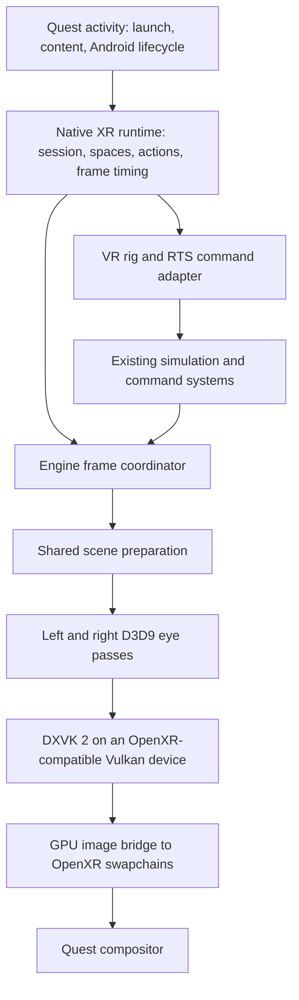

# Quest 3 standalone immersive VR port plan

Prepared 2026-09-23 from Android repository `eb1bb62` and Perimeter submodule `fd6daaed`. This is an architecture and implementation plan based on source inspection, not a headset compatibility or performance result. No builds or device experiments were performed for this analysis.

## Direction

Build a native OpenXR application for Quest 3, retaining the engine's D3D9 renderer through the pinned **DXVK 2.7.1** revision. The main experience is a tracked, stereoscopic god-like viewpoint above and within the battlefield. Tabletop is an optional camera preset and a useful first playable milestone. Both modes use the same world, renderer, controller actions, and coordinate conversion.

The port is feasible enough to justify a prototype, but its performance and DXVK/OpenXR compatibility remain unproven. Resolve graphics interoperability before investing in the complete VR interface. Tabletop reduces navigation and comfort work; it does not remove the stereo or OpenXR integration work and is not inherently cheaper to render when the whole map is visible.

Scope is standalone ARM64, controller input, existing game content and simulation, and DXVK 2 only. Do not develop Sokol or DXVK 1 VR paths. Passthrough, hand tracking, multiplayer UX, and advanced reprojection can follow the immersive single-player experience.

## Code findings and implications

References are to the inspected revisions; line numbers will move during implementation.

| Area | Evidence | Consequence |
| --- | --- | --- |
| Android entry | [Manifest](../app/src/main/AndroidManifest.xml), [MainActivity](../app/src/main/java/com/queststoredb/perimeter/MainActivity.kt) | Current launch is an Android panel followed by an SDL activity in `:game`. There is no native OpenXR session implementation in `app/src` or `Perimeter/Source`. |
| DXVK build | [AndroidDxvk.cmake](../app/src/main/cpp/cmake/AndroidDxvk.cmake#L154) | Generation 2 pins `c3dd74be6baec53786d4e064a572185b70347a17`; its cached pristine `meson.build` identifies 2.7.1. The build currently packages both generations. Add a Quest configuration that builds/packages only generation 2. |
| DXVK loading | [AndroidDxvkLoader.cpp](../app/src/main/cpp/AndroidDxvkLoader.cpp#L40), [GameLaunchOptions.kt](../app/src/main/java/com/queststoredb/perimeter/GameLaunchOptions.kt#L48) | The existing boundary exposes D3D9 creation and an SDL window. Quest needs an XR bootstrap before D3D9 creation, and a fixed generation-2 selection. The existing Vulkan version probe alone is insufficient to establish XR compatibility. |
| Presentation | [D3DRender.cpp](../Perimeter/Source/Render/D3D/D3DRender.cpp#L772) | `cD3DRender::Flush()` invokes D3D9 `Present`. XR needs a separate submission path, runtime pacing, and no required Android window presentation. |
| Render targets | [D3DRenderDraw.cpp](../Perimeter/Source/Render/D3D/D3DRenderDraw.cpp#L15) | Target switching exists, but `RestoreRenderTarget()` restores the window backbuffer. Nested shadows/reflections must restore the current eye target. `SetDrawNode()` caches camera identity; target changes must invalidate that cache where necessary. |
| Update/draw coupling | [GameShell.cpp](../Perimeter/Source/UserInterface/GameShell.cpp#L731), [Show](../Perimeter/Source/UserInterface/GameShell.cpp#L869) | `GraphQuant()` calls `Show()`, which advances clocks, updates placement/UI, draws the world and HUD, and presents. Calling it once per eye would duplicate frame work and time advancement. |
| Scene preparation | [Scene.cpp](../Perimeter/Source/Render/src/Scene.cpp#L122) | `Draw()` performs list updates, animation, visibility, shadows, and rendering. `Animate()` already consumes its time delta, so a second scene draw alone does not necessarily animate twice; that guard does not make the entire draw path stereo-safe. `PreDraw()` and `PostDraw()` are empty here. |
| Camera projection | [cCamera.cpp](../Perimeter/Source/Render/src/cCamera.cpp#L340) | The normal projection sets perspective offsets to zero. `ATTRCAMERA_NOT_CALC_PROJ` can preserve a supplied matrix, but frustum construction and ray generation still need an asymmetric-projection audit. Replacing only the projection matrix is insufficient. |
| Camera controls/picking | [CameraManager.cpp](../Perimeter/Source/Game/CameraManager.cpp#L431) | Picking converts a screen cursor into a scene ray; drag uses a separate flat plane. VR needs controller rays independent of a screen cursor and a rig independent of the legacy orbit camera. |
| Terrain lifecycle | [TileMapRender.cpp](../Perimeter/Source/Render/tilemap/TileMapRender.cpp#L251) | `PreDraw()` clears draw flags, frees tiles, and recalculates camera-dependent render lists. Sequential eye passes can change shared terrain state. Prepare residency/LOD once for the stereo view family. |
| Simulation scheduling | [ht.cpp](../Perimeter/Source/HT/ht.cpp#L205), [Runtime.cpp](../Perimeter/Source/Game/Runtime.cpp#L479) | Logic and graphics already have distinct paths and synchronization. Retain their tick/command semantics while introducing one XR graphics frame with two views. |
| RTS actions | [Universe.cpp](../Perimeter/Source/Game/Universe.cpp#L370), [ShellCmd.cpp](../Perimeter/Source/UserInterface/ShellCmd.cpp), [Installer.cpp](../Perimeter/Source/UserInterface/Installer.cpp#L155) | World-position commands and a world-position building placement overload are reusable. Adapt controller intent to these systems instead of implementing new simulation rules. |
| Sound | [Runtime.cpp](../Perimeter/Source/Game/Runtime.cpp#L951) | The listener follows `terCamera->matrix()`. VR should use a central head pose, with distance attenuation adjusted to the chosen world scale. |
| Diagnostics | [AndroidFrameTiming.h](../app/src/main/cpp/AndroidFrameTiming.h), [dxvkSmoke](../dxvkSmoke/src/main/cpp/DxvkSmoke.cpp) | Reuse native timings and the smoke-test structure, adding XR timing and compatibility fields. Existing phone/window benchmarks do not establish Quest stereo performance. |

## Architecture and ownership

Proposed Android-owned components under `app/src/main/cpp/xr/`:

| Component | Responsibility |
| --- | --- |
| `XrRuntime` | Loader, instance/session, events, spaces, swapchains, frame lifecycle, extension discovery. |
| `XrDxvkBridge` | DXVK bootstrap hooks, Vulkan interop, target transfer, queue coordination and resource lifetime. |
| `XrFrameCoordinator` | Once-per-frame preparation, eye passes, UI layer production and submission. |
| `XrCameraRig` | Tracking-to-world transform, world scale, navigation, recenter and camera-mode policy. |
| `XrInput` | OpenXR actions, controller poses, haptics and action cancellation. |
| `VrCommandAdapter` | Picking, selection, build/terrain tools, command queueing and panel interaction. |
| `VrPanels` | Comfortable placement of menus/HUD and mapping panel hits into existing UI coordinates. |

Names are proposed interfaces, not existing classes. Keep OpenXR/Vulkan types out of gameplay APIs. Small engine changes are necessary: a frame/view-family boundary, camera projection and ray support, render-target ownership, and world-space interaction seams. Use neutral C++ structures for these boundaries. Exodus currently supplies small platform utilities rather than a ready-made XR backend; avoid concentrating rendering and input logic there just because it is a platform layer.

## First technical gate: DXVK 2 and OpenXR on one device

Use `XR_KHR_vulkan_enable2`. Initialize the Android loader, create the XR instance/system, and query graphics requirements before initializing D3D9. Route DXVK's Vulkan instance and device creation through narrow Android-only callbacks to `xrCreateVulkanInstanceKHR` and `xrCreateVulkanDeviceKHR`; select the physical device returned by `xrGetVulkanGraphicsDevice2KHR`. Preserve DXVK's required features, extension lists, queue selection, and error diagnostics. The binding requires those creation calls and the runtime-selected physical device; obtaining arbitrary DXVK handles after startup is not enough. [Khronos Vulkan binding requirements](https://registry.khronos.org/OpenXR/specs/1.1/man/html/XrGraphicsBindingVulkan2KHR.html)

Source inspection of the cached pinned DXVK shows direct Vulkan creation in `src/dxvk/dxvk_instance.cpp:248` and `src/dxvk/dxvk_adapter.cpp:225`. It also has internal instance/device import machinery, but this is not an exposed D3D9 initialization contract. Prefer the narrow creation callbacks first; consider a D3D9 import extension only if that prototype demonstrates a smaller maintained change. Its existing OpenXR extension provider is registered under `_WIN32`, so it does not implement this Android integration.

Keep these changes in the existing reproducible patched-source build, controlled by an XR option in `AndroidDxvk.cmake` / `patch_android_dxvk.py`. Never edit generated `.cxx` source as the implementation. Version the callback ABI, register it before `Direct3DCreate9`, and retain it until DXVK destruction. Diagnose unsupported feature/API combinations explicitly.

The pinned D3D9 interop interfaces expose device/queue/image handles, image transitions, command flushing and queue locks. They can support a GPU transfer bridge. Their `CreateImage` method creates a resource; it does not accept an external `VkImage`, so direct wrapping of an OpenXR image is additional work. [Pinned DXVK interfaces](https://github.com/doitsujin/dxvk/blob/c3dd74be6baec53786d4e064a572185b70347a17/src/d3d9/d3d9_interfaces.h)

For the first version, render into two D3D9 texture targets plus depth surfaces, then copy or blit on the GPU into acquired OpenXR images on the same device. Negotiate actual swapchain formats, dimensions and usage flags; check transfer/format support. If necessary, use a small Vulkan conversion pass for presentation, keeping all game rendering in DXVK 2. Begin with one single-layer swapchain per eye to keep resource ownership simple. Use runtime-recommended sizes with an explicit measured resolution scale, not Android panel dimensions.

The smoke prototype must resolve these details before integration:

- Flush D3D9 work before external Vulkan use. A command-stream flush is not proof that the GPU is idle.
- Submit explicit barriers and GPU dependencies; restore DXVK image layouts before reuse. Track per-frame completion for staging targets and command buffers.
- Serialize use of the shared Vulkan queue, including OpenXR operations that may access it. Never call D3D9 methods while holding DXVK's submission lock; arrange flush/lock order to avoid deadlocks.
- Honor acquire/wait/release and the Vulkan layout requirements at handoff. Do not modify images after release, destroy runtime-owned images, or let pending GPU work reference destroyed resources.
- Prove D3D9 startup/reset can operate with an unused SDL window or a minimal XR-specific offscreen path. Do not require a functioning window swapchain or normal `Present()` to make rendering progress.
- Verify channel order, sRGB handling, vertical orientation, MSAA resolve, and depth/stencil compatibility independently.

OpenXR and Vulkan define the synchronization contract; serialize the runtime and DXVK on their shared queue. [OpenXR Vulkan extension specification](https://registry.khronos.org/OpenXR/specs/1.1-khr/pdf/xrspec.pdf)

Direct rendering into OpenXR images is a later optimization: add a narrowly scoped external-image D3D9 wrapper with non-owning lifetime semantics, supported formats, tracked layouts and attachment views. Keep the transfer path as a reference until the direct path is correct and measurably faster. No CPU readback in either path.

## Stereo frame and engine changes

The proposed frame order is:

1. Process Android and XR lifecycle events; run the XR frame loop only in a running session.
2. `xrWaitFrame`, then `xrBeginFrame`; retain the returned predicted display time and `shouldRender`.
3. Synchronize controller actions and obtain valid controller poses. Advance permitted game/UI work once, preserving existing simulation cadence and thread contracts.
4. Prepare a consistent scene state. Locate eye views for predicted display time late enough to reduce pose age, before final per-eye culling.
5. If rendering is requested and poses are valid, acquire/wait eye images, prepare shared terrain/scene resources, then draw each eye from the same state into its own color/depth target.
6. Produce menus/panels, transfer images, release swapchain images, and submit a projection layer with the corresponding runtime-space eye poses and FOVs.
7. End every begun frame correctly, including frames with zero layers when rendering is skipped. Release only images that were acquired and successfully waited on.

Use the runtime's pacing and predicted display time. [xrWaitFrame](https://registry.khronos.org/OpenXR/specs/1.1/man/html/xrWaitFrame.html), [xrLocateViews](https://registry.khronos.org/OpenXR/specs/1.1/man/html/xrLocateViews.html), [swapchain release](https://registry.khronos.org/OpenXR/specs/1.1/man/html/xrReleaseSwapchainImage.html)

Refactor `GameShell::Show()` into frame preparation, world-view drawing, UI drawing and completion. Retain a one-view implementation for ordinary Android/desktop callers. Do not run `GraphQuant()` twice, duplicate command dispatch, or advance clocks once per eye. Keep scene references valid across both eye passes under the existing logic/graphics synchronization rules.

Split `cScene::Draw()` preparation where needed: animation/resource changes once per frame; visibility, transparency ordering and billboards per eye. Initially accept two geometry submissions. Vulkan multiview is not a switch that automatically converts D3D9 draw calls and shaders into a stereo renderer.

Render-target restoration must return to the enclosing eye target after shadow/reflection work. Audit viewport/scissor dimensions, fullscreen effects, cached camera state, stencil clears, UI coordinates and readback/movie paths for window assumptions. Share shadow maps only when their coverage is correct for both eyes; preserve separate eye-dependent reflections and transparent ordering as needed.

Terrain needs a view-family preparation step before unrestricted stereo gameplay: choose residency and a common LOD from both views, conservatively retain tiles needed by either eye, and perform deformation/texture/seam updates once. Maintain separate visibility/draw lists without freeing another eye's resources. The existing [terrain LOD plan](terrain-lod-reimplementation-plan.md) is relevant; reuse its persistent-tile direction if needed. Do not make the entire terrain rewrite a prerequisite for the first low-complexity stereo scene.

## Immersive god-camera and tabletop

Represent the VR camera as a navigation rig plus physical tracking. Do not drive the legacy RTS orbit camera directly from headset yaw/pitch.

For positions, define a single transform:

`p_world = rig_origin + units_per_meter * R_world_from_tracking * p_tracking`

Apply its basis to orientations and controller rays; invert the resulting eye pose for the engine view matrix. Use runtime-supplied left/right poses and asymmetric FOVs. Convert OpenXR's axes to the engine's conventions explicitly, including handedness, matrix ordering and clip-depth conventions. Derive frustum planes, world-to-screen projection and unprojection consistently. Keep submitted OpenXR poses in the layer's XR reference space, rather than submitting engine-scaled coordinates.

World scale defines the giant's apparent size. Runtime IPD and physical movement are scaled through this transform together; do not invent eye separation independently. UI in XR meters should remain legible when world scale changes. Use one inverse transform for controller picking, placement and world manipulation. Keep near/far clipping numerically stable and test the supported scale range.

**Main god mode:** start above the battlefield with a stable horizon and free physical head movement. Provide pointer teleport/reposition, discrete altitude steps, snap yaw around the viewer, and an overview/minimap jump. Offer smooth horizontal flight, vertical motion and smooth yaw as opt-in settings with adjustable speed and comfort vignette. Keep locomotion direction configurable between controller direction and rig-forward; avoid forcing movement to follow head turns. Do not apply artificial pitch/roll or camera shake to tracked vision.

Constrain the rig against terrain/map limits without clamping normal small head movements. If the user physically leans into terrain, use a fade/occlusion policy instead of pushing their head pose. Scripted camera tours and abrupt camera restores should become user-triggered repositioning with a transition, or play on a panel. Audio should follow the central head orientation, not either eye, with a separate policy for strategic-distance audibility.

**Tabletop preset:** use the same transform at a miniature scale, place the map at a comfortable seated/standing height, and support reposition/yaw/scale around a selected pivot. Preserve the selected world point when changing scale to avoid a jump. Two-hand world manipulation can follow basic single-controller controls. A bounded presentation may need edge treatment for water/chaos/sky and effects outside the map. Passthrough and persistent room anchors are optional later features.

Recenter changes the rig/reference-space relationship while preserving the intended world location. Handle reference-space changes and invalid tracking without emitting commands. Seated mode must not depend on floor tracking being available.

## RTS input and interface

Use OpenXR actions and suggested bindings for supported Quest controllers. SDL remains useful for sound, existing input compatibility and the platform shell; pose/controller acquisition belongs to OpenXR. Make handedness configurable and clear held actions on focus loss or controller disconnection.

| Intent | Initial interaction |
| --- | --- |
| Select | Dominant trigger raycasts a unit; modifier adds/removes selection. |
| Group select | Explicit selection mode with a controller-drawn ground area; retain squad/group shortcuts. |
| Move/attack/interact | Separate command action on the current target, with visible preview and confirmation feedback. |
| Queue commands | Held modifier or explicit queue toggle, mapped to existing command modes. |
| Build/rotate/cancel | World-ray placement ghost, snap rotation, clear validity feedback, confirm/cancel actions. |
| Terraform | Ground ray and visible brush footprint, adjustable radius, explicit start/stop and mode selection. |
| Navigate | Teleport/altitude/snap turn defaults; optional smooth flight. |
| Strategic controls | Repositionable panel for production, research, upgrades, squads, minimap, objectives and pause. |

Reuse `terScene::Trace()` for terrain intersection after applying map bounds and distance limits; add an appropriate unit/object ray query using existing selection filters. A terrain hit alone cannot select flying units. Apply visibility/fog-of-war, ownership and command validity rules through existing systems. Route confirmed commands through `terUniverse`/selection and the established logic queue. Do not keep raw unit pointers across frames when units may be deleted.

Use a semantic interaction context carrying world ray, hit position/object, modifiers, and command intent. Adapt screen-based shell callers at the boundary. Reuse `terBuildingInstaller::SetBuildPosition(Vect3f, angle, player)` for placement while preserving script and terrain checks. Ground dragging and selection-area semantics need explicit treatment on slopes and near map edges.

Initially render existing menus/HUD into a texture on a movable world-space panel or OpenXR quad layer. Transform controller hits into its original pixel coordinates for UI events. World input must not fire through the panel. Keep selection markers, paths, brush footprints and placement previews in stereo world space. A 2D panel is appropriate for menus, not a substitute for stereo battlefield rendering.

Progressively replace dense HUD interactions with comfortable panels/radial commands and controller prompts. Keep text, targets and panel distance usable across seated/standing play and world scales. Provide all keyboard-dependent functions needed to complete a mission, including save/load, naming/text entry, mission dialogs, pause and exit. Compose may serve Android setup screens; it does not automatically become an immersive panel.

## Android lifecycle and packaging

Add a Quest build dimension/configuration with its own manifest and native XR option. Reuse content storage and the existing engine library. Keep a small activity responsible for Android lifecycle and JNI context, with the session owned by native code. Prototype reusing SDLActivity; if its surface-driven pause logic blocks XR, introduce a dedicated Quest host with an explicit SDL lifecycle adapter.

Add the immersive launcher category and initialize the loader with Java VM/activity context. Pin a tested loader dependency rather than copying an old sample version blindly. Meta documents the Khronos Android loader and required Android initialization extensions. [Meta OpenXR setup](https://developers.meta.com/horizon/documentation/native/android/mobile-openxr/)

Keep content selection/permission setup available before immersive launch, then enter the XR activity directly for normal play. Store setup state across the separate game process. Account for headset removal, dashboard focus changes, session stop/loss, Android pause/resume, loading and return to launcher. Current `MainActivity.onDestroy()` discards the game process because native globals are not safely reinitialized; preserve that constraint initially, with orderly XR/GPU teardown first. Do not interpret a transient loss of focus as a full restart.

Pause single-player gameplay appropriately on focus loss; preserve head tracking/rendering when the session remains visible. For long mission loads, present an XR loading layer if the engine load path can be separated safely; identify blocking global initialization before introducing a render thread. A moving head must not be tied to simulation speed or asset-loading stalls.

Use the Studio-compatible Gradle cache, host ccache, normal signing, and `releaseBenchmark` diagnostics variant from AGENTS.md. Keep O2/ThinLTO defaults for the control. Record the new Quest task names once implemented; no Quest Gradle task exists in this plan yet. Recheck current distribution manifest/SDK/storage requirements when preparing a release; the source's `targetSdk = 37` is not evidence of Quest store eligibility.

## Performance approach

Set **72 Hz native rendering** as the initial proposed target: 13.89 ms per displayed frame. Evaluate 90 Hz (11.11 ms) after sustained measurements. These are project targets, not measured capabilities. CPU and GPU work overlap, so measure their critical paths and compositor deadlines rather than adding average stage times. Reserve margin for runtime work, scheduling variation and thermal changes.

Measure engine preparation, each eye's CPU submission, GPU world rendering, transfer cost, XR wait/acquire/submit, missed frames, memory and load spikes separately. Record runtime/OS, driver, DXVK revision, resolution, refresh rate and settings. SurfaceFlinger window timings alone do not describe XR delivery.

Proposed initial acceptance criteria: three repeatable runs for each representative workload, followed by a 30-minute thermal session; less than 1% missed application frames after warm-up, no recurring multi-frame stalls during ordinary navigation, and no unbounded memory growth across repeated mission loads. At 72 Hz, aim for CPU application work and GPU application work each below 11 ms at P95, excluding intentional runtime pacing waits. Treat these as starting engineering gates to refine against actual runtime overhead and in-headset results, not a promise that this code already meets them.

Prioritize according to measurements:

1. Shared terrain/scene updates and elimination of resource churn during navigation.
2. Draw-call/batching cost and expensive shadows/reflections/particles at large overview distances.
3. Eye resolution scaling and quality presets with stable text/UI resolution.
4. Direct swapchain-image rendering if the extra transfer is material.
5. Fixed foveation after its attachment/image requirements are supported end to end.

Foveating only the destination of a fully rendered image copy will not reduce upstream scene shading. Native Vulkan foveation requires a compatible swapchain/rendering integration; do not assume DXVK's ordinary offscreen targets support it automatically. [Meta fixed foveation](https://developers.meta.com/horizon/documentation/native/android/os-fixed-foveated-rendering/)

Do not budget around Application SpaceWarp initially: it requires additional integration and motion/depth output, not merely submitting the existing color image. [Meta Application SpaceWarp](https://developers.meta.com/horizon/documentation/native/android/mobile-asw/)

Profile representative heavy combat, deformation, construction, mission transitions and long overview movement, not only an empty tabletop. Budget both eye targets/depth, runtime swapchains, UI, DXVK pools and loaded mission assets. Log GPU memory separately from overlapping Android PSS categories. Use the existing tutorial benchmark concepts, but replace touch/window automation with deterministic XR rig/action scenarios and runtime timing collection.

## Delivery sequence and gates

| Phase | Deliverable and main touchpoints | Completion gate |
| --- | --- | --- |
| 0. Headset feasibility | Extend `dxvkSmoke` or add an isolated XR smoke target; XR loader/activity; pinned DXVK bootstrap and interop probe. | Real Quest 3 creates the shared XR-compatible device and displays distinct D3D9 eye images under head movement; lifecycle and synchronization work without window Present. Record capabilities and transfer cost. |
| 1. Engine stereo foundation | Frame/view-family split in `GameShell`, `Scene`, D3D render target management and camera math. | Small scene has correct tracked stereo, asymmetric frusta, consistent animation and eye ordering; mono callers preserve behavior. |
| 2. First playable tabletop | Shared stereo terrain state, world ray interaction, selection/move/build and legacy UI panel. | A fresh Tutorial is playable in 6DoF with both controllers; essential tasks work and terrain does not flicker or rebuild differently between eyes. |
| 3. Main immersive god mode | Rig navigation, scale/altitude, map/terrain boundaries, head-based sound, cinematic policy, comfort options. | Tutorial can be completed from the immersive viewpoint with teleport/snap defaults; no forced camera pitch/roll or dependency on tabletop. |
| 4. Complete RTS usability | Terraforming, production/research/upgrades, queued commands, groups, minimap, mission dialogs, save/load and onboarding. | A representative full mission is completed entirely in-headset, with no keyboard or Android panel intervention during normal play. |
| 5. Sustained performance | Profile/optimize on Quest; direct image integration and terrain improvements if justified. | Meet the selected native refresh target in representative prolonged sessions with acceptable tail latency and stable memory; document quality limits and measured margins. |
| 6. Release hardening | Loading, focus/session loss, recenter, controller loss, content setup, packaging and regression review. | Reliable cold launch/resume/relaunch and release artifact; all required gameplay flows and platform checks pass. |

Phases 0 and 1 are prerequisites for both camera modes. Tabletop is a bounded first milestone, not a separate branch of the renderer. Begin performance measurement in phase 0 and carry it through every phase; phase 5 is the final sustained-performance gate. If phase 0 fails, resolve the DXVK 2 integration blocker explicitly before proceeding.

Future verification should cover matrix/ray consistency, once-per-frame state advancement, target restoration after nested passes, moving/deforming terrain in stereo, transparent effects, controller focus cancellation, unit deletion during selection, and repeated load/unload. Assess stereo and comfort inside the headset; mirror images and source inspection cannot establish those results.

## Phase 2 implementation record: first playable tabletop

### Accepted scope

Phase 2 is complete for the agreed first-playable tabletop scope. On Quest 3, normal mission starts, tracked controller interaction, table translation and yaw, HUD hover and click, live unit movement, building placement, focus recovery, and stereo terrain consistency have been confirmed. The [progress tracker](quest3-immersive-vr-progress.md) records the implementation and headset evidence. This completion records the accepted scope; it does not close the later lifecycle, positioning, or performance gates.

The implementation keeps Quest runtime code in the `quest` product flavor and `ANDROID_XR` path. Shared engine seams are guarded so the standard mobile and PC paths retain their existing behavior. The Quest and mobile benchmark variants were built during this work; detailed build and device observations are in the progress tracker.

### Implemented areas

| Area | Result |
| --- | --- |
| P2-1. Controller input | OpenXR Touch actions provide left and right aim poses, thumbsticks, select/command/menu/cancel/rotate inputs, and press/release edges. Focus loss and invalid aim clear held input. |
| P2-2. Tabletop rig | One `XrCameraRig` transform maps both eye poses and controller rays. Left-stick translation, right-stick yaw, and runtime Meta-button recentering were confirmed. Scale adjustment and seated fallback remain deferred. |
| P2-3. Stereo terrain | Both eye visibility regions contribute to one terrain LOD/residency preparation per XR frame. Headset checks confirmed consistent terrain across tile boundaries and during terrain updates. |
| P2-4. World interaction | Controller rays select friendly units, clear empty selection, and issue ground movement commands. Live unit movement was confirmed on Quest. |
| P2-5. Building placement | Controller aim updates the existing placement ghost; rotation, valid-location confirmation, cancel, and focus-loss cleanup use the existing placement checks. Building placement was confirmed in-headset. |
| P2-6. HUD panel | The legacy HUD/menu draws once to a shared OpenXR quad panel. Ray hover, pointer, and click behavior were confirmed. Panel height, positioning, and repositioning polish remain deferred. |
| P2-7. Normal flow | The normal Quest path successfully starts missions through the shared menu panel. Cold-launch, resume, and relaunch regression coverage remains in Phase 6. |

### Deferred gates

- Menu/HUD height and placement polish, panel repositioning, map scale controls, and seated fallback remain follow-up work.
- Cold launch, resume, relaunch, and broader session-loss regression remain in Phase 6.
- Full mission completion and advanced strategic controls remain in Phases 3 and 4. Sustained performance remains in Phase 5.

## Decisions carried forward after Phase 2

The measured DXVK 2 D3D9-to-OpenXR Vulkan GPU-copy bridge remains the Quest rendering path. Keep measuring transfer cost and scene complexity; consider direct-image wrapping only if the panel or gameplay path exposes a specific blocker.

Stereo terrain now shares visibility, LOD, and residency preparation across both eyes once per XR frame. Further terrain LOD changes remain independent of the completed Phase 2 seam. Menu/HUD placement and table scale are deferred as described above, and broader session-loss hardening remains in Phase 6.
